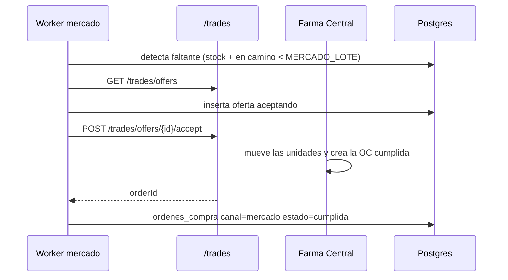

# Issue 20 — OC de mercado ya cumplida

https://github.com/arturopachecoh/Proyecto_Integracion/issues/20

## Qué quedó

Cuando aparece `orderId`, `orden.registrar` inserta una fila en `ordenes_compra`:

- `canal = mercado`
- `estado = cumplida`
- `estado_remoto = cumplida`
- `decision = {rol, contraparte, precio_unitario}`
- `origen_ref` = id de la oferta

La clave es el `orderId`. La segunda vez no inserta.

Si el rol es `vendedor`, antes se cierra la venta en custodia: `Venta.canal = mercado`, `estado = orden_compra`, `VentaUnidad` en `despachada`. Eso hace que el recall vea la entrega. El comprador no crea venta: las unidades todavía no están, y cuando llegan las registra el worker de frío como lote de otra distribuidora (issue 19).

No se llama a SOAP. Facturar y pagar es del desarrollador 2, que lee cualquier OC `cumplida` en la que este grupo es el proveedor (`decision.rol` distinto de `comprador`). No necesita otro cambio de esquema para ver estas filas.

## Secuencia hasta el `orderId`

`emitInvoice` y `payInvoice` no están en este diagrama. Los hace el desarrollador 2 cuando lee la fila.

No hay webhook. El mismo dato entra por el refresh del tick siguiente si el accept no trajo el `orderId` en el momento.

## Supuestos

- Farma crea la OC y entrega el `orderId` en el accept o en el GET de la oferta. Si no viene, la oferta queda `aceptando` y se vuelve a mirar.
- El comprador y el vendedor pueden insertar la misma OC cada uno en su base. Acá solo se inserta la de este grupo. `decision.rol` dice de qué lado estamos.
- `despachado_remoto` se llena con la cantidad de la oferta. No se consulta el sistema de órdenes.

## Prueba

`tests/test_mercado_db.py`: la misma OC dos veces deja una sola fila, `canal=mercado`, `estado=cumplida`, `rol=vendedor`.
