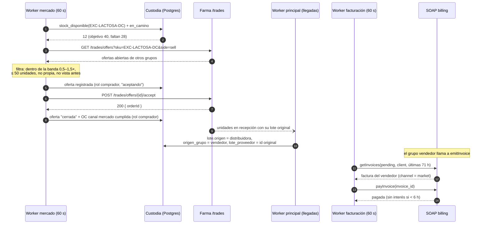
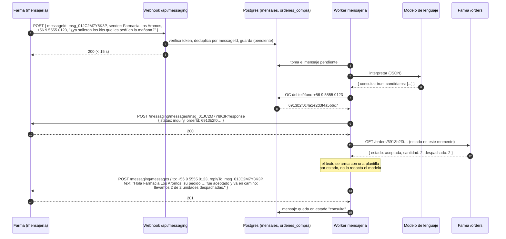

# Diseño de la Solución — Entrega 3

**Arturo Pacheco - Luis Reyes - Mario Ernst** · Grupo 4 (choripan4)

> Borrador. Lo marcado con `[COMPLETAR]` depende de datos de producción o del grupo.

En la Entrega 3 la distribuidora opera como un negocio. A lo que ya teníamos de la E2 le sumamos dos procesos nuevos, cada uno en su propio contenedor: `mercado` y `facturacion`. Así, una llamada lenta a `/trades` o al SOAP no frena el portal, el visor ni el despacho de las OC. Los dos procesos guardan su estado en el mismo Postgres que la custodia. Las migraciones `e3d1a0mercado`, `e3f2factura` y `e3g3consulta` agregan las tablas y columnas nuevas.

---

## DIAGRAMAS DE SECUENCIA POR PROCESO

**Compra en el mercado, hasta pagar la factura.** El worker del mercado da una vuelta cada 60 segundos. Si a un insumo escaso le faltan unidades para llegar al objetivo, busca ofertas de venta de otros grupos, acepta la más barata y deja registrada la OC de mercado. Las unidades llegan después a recepción, con su lote original. La factura la emite el grupo vendedor, y nuestro worker de facturación la encuentra como pendiente y la paga.

**Consulta de estado (ejemplo del enunciado).** El webhook responde de inmediato y deja el mensaje pendiente. El worker de mensajería lo interpreta con el modelo de lenguaje. Si es una consulta, busca la OC por el teléfono del cliente, la clasifica como `inquiry` y le escribe al cliente con el estado que Farma tiene en ese momento.

---

## JUSTIFICACIÓN DE DECISIONES DE DISEÑO

### Mercado y facturación en procesos aparte

Decidimos que el mercado y la facturación corran cada uno en su propio worker, en vez de agregarlos al worker principal o al portal. Lo hicimos porque las dos cosas dependen de servicios externos que pueden demorarse (`/trades` y el SOAP), y el enunciado mide la disponibilidad del portal y del visor cada 2 minutos.

Ganancias
- Si el SOAP o `/trades` se ponen lentos, el portal, el visor y el despacho de las OC siguen respondiendo.
- Cada worker tiene su propio ritmo y su propio presupuesto de llamadas: el mercado hace como máximo 20 requests por vuelta y la facturación, 10 emisiones y 10 pagos por minuto.
- Si un worker se cae, al volver retoma solo, porque el estado está en Postgres y en Farma, no en memoria.

Pérdidas
- Hay dos contenedores más que levantar y monitorear.
- El mercado y la fabricación compiten por las mismas unidades. Lo resolvimos con un candado de Postgres y apartando las unidades de cada oferta (más abajo), pero agrega complejidad.

### La fuente de verdad del dinero es el SOAP

Para las facturas recibidas decidimos no guardar una copia propia. En cada vuelta le preguntamos al SOAP qué está pendiente de pago y pagamos eso. En las facturas emitidas guardamos el `factura_id` en la propia OC, pero el SOAP es el que nos protege del duplicado.

Ganancias
- Una caída de nuestro servidor no puede dejar una factura olvidada: al volver, sigue apareciendo como pendiente.
- No hay que sincronizar nuestra contabilidad con la de Farma.

Pérdidas
- Dependemos de que `getInvoices` responda. Si el SOAP está caído no pagamos, pero tampoco hay forma de pagar sin él.
- El SOAP limita las llamadas por minuto y los rangos de fecha a 3 días, así que hay que repartir el trabajo en varias vueltas.

### El estado que se le informa al cliente sale del sistema, no del modelo

En las consultas de estado el modelo de lenguaje solo clasifica el mensaje y sugiere el kit. El texto que le llega al cliente se arma con una plantilla a partir del estado que entrega Farma en ese momento.

Ganancias
- El modelo no puede inventar un estado ni una cantidad despachada.
- Las respuestas son predecibles y fáciles de probar.

Pérdidas
- Las respuestas son menos naturales que si las redactara el modelo.

---

## MERCADO Y ESTRATEGIA DE ABASTECIMIENTO

Somos el grupo 4. Farma Central nos vende tres de los insumos críticos: `LAM-BLISTER-PVC`, `EXC-SUERO-FISIO` y `SOB-PAPEL-EST`. Los otros cuatro (`EXC-LACTOSA-DC`, `FRA-VIDRIO-120`, `VIA-VIDRIO-10` y `EXC-JARABE-BASE`) tenemos que conseguirlos en el mercado. La asignación está fija en `app/mercado/escasez.py`, y la reposición la consulta antes de pedirle a Farma, así que nunca mandamos una solicitud que Farma va a rechazar.

Cada 60 segundos el worker del mercado da una vuelta y hace lo siguiente, en este orden:
1. Revisa el estado de sus ofertas abiertas, porque el mercado no avisa por webhook cuando una se cierra.
2. Para cada insumo que nos falta, compra.
3. Para cada insumo que podemos comprarle a Farma, vende.

- **Cuándo comprar:** cuando el stock disponible más lo que viene en camino de un insumo escaso baja de 40 unidades (`MERCADO_OBJETIVO`). Del lado de los kits, el objetivo de stock bajó a 2 más 1 para el portal. Con 5 más 2, el arranque desde cero compraba de más y llenaba la bodega en una hora. Reponer un kit toma unos 15 minutos y una OC da cerca de 2 horas de plazo, así que 3 alcanza.
- **Cuánto comprar:** aceptamos ofertas ajenas de hasta 50 unidades. Si no hay ninguna conveniente, publicamos una oferta de compra propia de 5 unidades (`MERCADO_LOTE`), con una sola abierta por insumo. De a poco se cierran más operaciones para la meta de 30, y no se llena la recepción ni el pulmón.
- **A qué precio comprar:** aceptamos la oferta más barata dentro de la banda. Al principio pusimos un tope de 1,2× el precio vigente, pero el comprador automático vende lactosa y jarabe a ~1,5× y sin esos insumos se rechazaba la mitad de las OC. Por eso lo subimos (`TOPE_COMPRA` = 1,6), y en la práctica el límite es el techo de la banda, 1,5×. Probado 20 horas en dev desde cero, se cumplió entre el 92 % y el 98 % de las OC. Nuestras ofertas de compra se publican a 1,0×, porque al piso de la banda nadie las acepta.
- **Qué vender:** nuestros tres insumos exclusivos, que les faltan a otros cuatro grupos. Primero aceptamos ofertas de compra de otros grupos, que es la venta más segura. Después publicamos una venta de 5 unidades por insumo. Si el stock baja de un lote, le compramos un lote a Farma para tener qué revender.
- **A qué precio vender:** partimos en 1,0× el precio vigente y bajamos 0,1× por cada oferta propia que expira seguida, hasta 0,5×. Nunca vendemos bajo 1,2× del costo del catálogo, que es lo que Farma nos cobra en sus facturas.

Resguardos:
- Una oferta de venta **aparta** sus unidades (tabla `oferta_unidades`), igual que Farma las custodia. Mientras la oferta está abierta, esas unidades no aparecen en el stock disponible, no se usan para fabricar y no se despachan a clientes.
- Antes de vender revisamos que el área de despacho tenga espacio, y siempre dejamos 5 lugares libres para las OC de clientes. Sin esto, el mercado bloqueaba el despacho de sFTP y Pub/Sub.
- Si Farma rechaza una publicación o una aceptación (fuera de banda, o la tomó otro grupo), se revierte todo: las unidades se liberan y vuelven a bodega o a frío.
- Un candado de Postgres (`pg_try_advisory_lock`) impide que dos copias del worker aparten el mismo stock.

---

## FACTURACIÓN

El worker de facturación corre cada 60 segundos. En cada vuelta emite lo que falta facturar y paga lo que nos cobraron.

**Cada OC cumplida se factura exactamente una vez.** La migración `e3f2factura` agrega a `ordenes_compra` las columnas `factura_id` (vacía significa que falta facturar) y `factura_error`. Facturamos las OC cumplidas en las que somos proveedores: todas las de sFTP, Pub/Sub y mensajería, y las de mercado en que fuimos vendedores. Las compras de mercado las factura el otro grupo.

- Llamamos a `emitInvoice` y **solo después de que el SOAP confirma** guardamos el `factura_id` en la OC.
- Si el servidor se cae justo entre la emisión y el guardado, la OC sigue sin factura y en la vuelta siguiente se vuelve a emitir. El SOAP responde `DUPLICATE_OPERATION` y la marcamos como facturada. Así nunca hay dos facturas por la misma OC, aunque se repita la llamada.
- Si el SOAP falla (timeout, error 5xx o una página HTML de un proxy), el error queda en `factura_error` y la OC sigue pendiente. Las que fallaron pasan al final de la cola, para que una OC con problemas no tape a las demás.
- Si el SOAP pide esperar (429), cortamos la vuelta y seguimos en la próxima. El SOAP acepta 60 llamadas por minuto, por eso cada vuelta hace como máximo 10 emisiones y 10 pagos.

**Cada factura recibida se paga dentro de plazo.** No guardamos las facturas recibidas: en cada vuelta pedimos `getInvoices(pending, client)` de las últimas 71 horas, porque el SOAP acepta rangos de hasta 3 días y el período dura 60. Pagamos primero las más antiguas, que son las que están más cerca de empezar a cobrar interés. Con una vuelta por minuto, una factura se paga en 1 a 2 minutos, muy lejos de las 6 horas sin interés. Aunque el worker esté caído varias horas, al volver paga todo lo pendiente.

El panel `/pedidos` muestra el saldo (`getBankStatement`) y un resumen de ingresos, costos e intereses por canal. Con eso contrastamos nuestra contabilidad con la de Farma.

Un detalle que nos costó encontrar: el SOAP responde 401 si la clave de WS-Security no lleva el atributo `Type="...#PasswordText"`, aunque la clave esté bien. Por eso armamos el sobre a mano en `app/billing_client.py`.

---

## CONSULTAS DE ESTADO

**Cómo identificamos la OC.** La conversación se guarda por teléfono: cada mensaje queda en la tabla `mensajes` con el teléfono, el remitente y, si generó un pedido, el `oc_id`. Para responder una consulta:
1. Si el cliente cita el ID de la OC, usamos ese.
2. Si no, tomamos la OC más reciente de ese teléfono del kit que nombra (el modelo devuelve los kits candidatos). Si no nombra ninguno, tomamos la más reciente.
3. Si el teléfono no tiene pedidos, buscamos por el nombre del cliente. Si tampoco aparece, descartamos el mensaje en vez de inventar una OC.

**Cómo evitamos informar un estado que no corresponde.**
- El modelo no decide el estado. El texto sale de una plantilla fija por estado (creada, aceptada, cumplida, rechazada o vencida) con el estado, la cantidad y las unidades despachadas que Farma entrega en ese momento.
- El estado se consulta a Farma al momento de responder, no se copia de nuestra base, que podría estar desfasada.
- Si Farma responde 404 al clasificar (la OC no existe o no es nuestra), el mensaje se descarta y no se le escribe al cliente.
- Si falla el envío al cliente por un error transitorio, el mensaje sigue en `respondiendo` y la vuelta siguiente reintenta. `/response` responde 409 porque ya estaba clasificado, y se vuelve a escribir.
- Plazo: el gateway del modelo admite un prompt por minuto, así que atendemos un mensaje por minuto en orden de llegada. Con unos 3 mensajes por hora, quedamos dentro de los 30 minutos.

`[COMPLETAR: decidir si se mantiene la búsqueda por nombre del paso 3. El enunciado dice que la consulta siempre se refiere a un pedido hecho por mensajería desde el mismo teléfono, así que esa búsqueda podría elegir una OC de otro canal.]`

---

## RETIRO DE LOTE Y MODELO DE CUSTODIA

### Qué cambió en la custodia

En la E1 todos los lotes que recibíamos venían de Farma. Ahora un lote también puede venir de otra distribuidora, y nosotros podemos venderle unidades a otra. El enunciado pide registrar a quién se le compró y a quién se le vendió cada unidad. Para eso agregamos:

- **En `lotes`:** `origen = distribuidora`, `origen_grupo` (el grupo que nos vendió) y `lote_proveedor` (el ID de lote original). La unidad conserva su ID de lote, así que el retiro la encuentra igual que si viniera de Farma.
- **Tabla `ofertas_mercado`:** cada operación, con su lado, insumo, cantidad, precio, estado, `order_id`, grupo contraparte, nuestro rol y cuántas unidades ya recibimos.
- **Tabla `oferta_unidades`:** qué unidades exactas aparta una oferta de venta. Cada unidad puede estar en una sola oferta.
- **En `ordenes_compra`:** el canal `mercado`, y en `decision.rol` si fuimos vendedores o compradores.
- **Al cerrar una venta:** se crea una venta de canal `mercado` con sus unidades marcadas como despachadas. Es idempotente por `order_id`. Así el retiro la encuentra como una entrega más.

**Cómo sabemos que una llegada es una compra del mercado.** Cuando aparecen unidades en recepción, buscamos la oferta de compra cerrada más antigua de ese insumo que todavía no recibe todas sus unidades. Si existe, el lote se registra como de otra distribuidora y se suma al contador de recibidas, para no atribuirle llegadas de más. Si no existe, es una recepción normal de Farma. Seguimos la misma idea de la E1: no inventamos relaciones.

### Cómo decidimos, ante cada aviso, si el lote pasó por nosotros

Ahora cada aviso llega a las 7 distribuidoras. La respuesta sale solo de nuestra custodia:

1. Buscamos el código de lote del aviso en `lotes`. Un lote comprado a otro grupo tiene su ID original, así que se encuentra igual que uno de Farma.
2. **Si no está, el lote no pasó por nosotros.** Enviamos el reporte vacío y no movemos nada a cuarentena. Lo registramos como información y no como error, porque es el caso normal.
3. Si está, recorremos la genealogía (`lot_relations`) para encontrar los derivados. Un lote fabricado con insumos de dos lotes afectados aparece una vez por cada padre, como lo cuenta Farma. Reportamos stock, derivados y entregas.
4. **Las ventas en el mercado van en el reporte como entregas, pero no se notifican.** La compradora recibe el mismo aviso y responde por su parte.
5. Si una unidad retirada estaba apartada en una oferta de venta abierta, se suelta y la oferta se cancela en la vuelta siguiente del mercado. Así no vendemos un lote retirado.

---

## RESULTADOS DEL NEGOCIO

`[COMPLETAR el viernes 20 después de las 22:00, con el panel /pedidos y getBankStatement]`

| Concepto | Monto |
|---|---|
| Ingresos facturados — sFTP | `[ ]` |
| Ingresos facturados — Pub/Sub | `[ ]` |
| Ingresos facturados — mensajería | `[ ]` |
| Ingresos facturados — mercado | `[ ]` |
| Costos — Farma Central (compras) | `[ ]` |
| Costos — bodega externa (pulmón) | `[ ]` |
| Costos — compras en el mercado | `[ ]` |
| Intereses acumulados | `[ ]` |
| **Margen** | `[ ]` |
| Operaciones en el mercado (vendedora / compradora) | `[ ] / [ ]` |
| OC cumplidas facturadas | `[ ] %` |

**Principales costos e ingresos.** `[COMPLETAR]`

**Qué cambiaríamos.** `[COMPLETAR con lo observado. Ideas a evaluar: ajustar MERCADO_OBJETIVO según el consumo real; subir el precio de venta cuando nuestras ofertas se toman rápido, no solo bajarlo cuando expiran; comprar el producto acondicionado o el kit cuando salga más barato que el insumo.]`

---

## DECLARACIÓN DE USO DE INTELIGENCIA ARTIFICIAL

**Modelos dentro del sistema.** El worker de mensajería usa `[COMPLETAR: modelo de LLM_MODEL en producción]` a través del gateway del curso. Lo usamos para clasificar cada mensaje (pedido, consulta u otra cosa) y para extraer kit, cantidad y fecha en JSON. No redacta las respuestas a las consultas de estado: ese texto se arma con plantillas a partir del estado real de la OC. Su salida nunca se usa directo. Pasa por validaciones deterministas (catálogo, cantidad, fecha y plazo, desempate de kits) antes de crear una OC, y el estado de las consultas lo da Farma.

**Arturo Pacheco:** `[COMPLETAR]`

**Luis Reyes:** `[COMPLETAR]`

**Mario Ernst:** `[COMPLETAR]`

**Cómo verificamos.** Tests automáticos de lo nuevo (`test_mercado.py`, `test_mercado_db.py`, `test_trades_client.py`, `test_escasez.py`, `test_mensajeria*.py`, `test_retiros_db.py`), una corrida de 20 horas en dev desde cero, y pruebas en producción el 16 de noviembre del mercado, el SOAP, el chat de prueba y los retiros. `[COMPLETAR/confirmar]`
